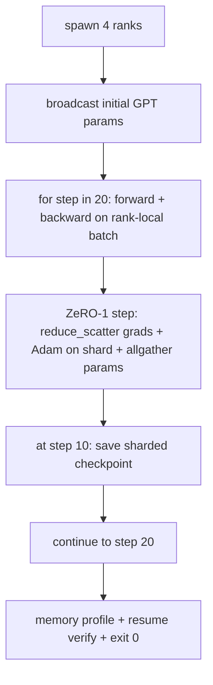

# 종말 으로 분산 된 훈련

> 76~80번 강의는 각각 하나의 조각을 구성했습니다. 이것은 집합입니다. gradient sync를 위해 DDP, Optimizer-state sharding을 위해 ZeRO-1와 중간에 점검하는 점검하는 작은 GPT를 훈련시켜 4 개의 시뮬레이션 순위를 통해 훈련합니다. 데모는 20 단계를 실행하고, 자궁화, 손실 곡선을 더하여 메모리 프로파일을 인쇄하고, 재작업 가능한 점검점을 작성합니다.

**Type:** Build
**Languages:** Python
**Prerequisites:** Phase 19 Track C lessons 42-49
**Time:** ~90 min

## 학습 목표

- DDP (77강) 과 ZeRO-1 (78강) 과 분단된 체크포인트 (80강) 를 하나의 훈련 루프로 구성한다.
- 작은 합성 코퍼스에서 2층 트랜스포머 언어 모델을 4 개의 시뮬레이션 순위에서 20 단계 동안 훈련하십시오.
- 단계별 손실 테이블, 순위별 메모리 프로필, 그리고 같은 세계 크기에 바이트-평등으로 재개되는 체크포인트 매니페스트를 인쇄합니다.
- 작곡을 옹호하라: 각 작품은 이전 수업에서 독립적으로 테스트 할 수 있으며 이 수업은 그들이 작곡한 것을 증명합니다.

## 문제

석탑은 조각들이 서로 어울리는 증거입니다. 76강습 시행 집단 77강습은 그들을 DDP에 묶어 놓았습니다. 수업 78 reduc_scatter와 함께 쪼개진 최적화 상태 79강습에서 파이프라인을 분석했습니다. 80강은 분해된 체크포인트를 구해줬습니다. 각각의 교훈은 그 자체로 시험이 있었다. 실제 훈련 경기는 모든 원시자를 동시에 사용합니다. 구성이 잘못되면 손실이 떨어져, 체크포인트가 재개하기를 거부하거나 순위 기억이 줄어들어야 할 때 증가합니다.

이 수업은 엔드-투-엔드 디모를 실행하고 네 가지 변수를 확인합니다: (a) 플롯 소음의 20 단계 내에서 손실이 단조적으로 감소합니다. (b) 각 순위는 모든 단계에 동일한 매개 변수 규범을 유지합니다. (c) 순위 최적화 메모리는 ZeRO-1 공식 12P/N 바이트와 같습니다. (d) 단계 10의 체크포인트가 재부팅 시 바이트와 같습니다. 데모가 자율적으로 종료됩니다. 20 단계, 단일 명령, 출구 0.

## 개념



### 미니 GPT

모델은 의도적으로 작습니다. 2개의 트랜스포머 블록, 임베디드 디밍 32, 4개의 주의력 헤드, 워커 64, 염기 길이 16, 배트 4. 몇 천개의 매개 변수. 모든 케이블 결정을 실행하기에 충분한 크기가 (다 헤드 관심은 표준 마스크 된 경로를 실행합니다. LayerNorm에는 동기화 할 무게가 있습니다. LM 헤드는 음성으로 분리된 선형 투명입니다.) 4개의 CPU 순위에 20개의 단계가 초 안에 끝나는 만큼 작습니다.

### 구성 규칙

| Lesson piece | What it owns | What it leaves to the loop |
|--------------|--------------|----------------------------|
| DDP broadcast | Initial parameter sync | One call at construct time |
| ZeRO-1 step | Gradient sync, master copy update, parameter broadcast | One call per step replacing optimiser.step |
| Sharded checkpoint | Persist per-rank state, manifest with sha256 | Called on rank 0 with state collected via allgather |
| Training loop | Forward, backward, loss logging | Calls the three above in order |

루프는 reduc_scatter 또는 rendezvous 파일에 대해 알지 못합니다. ZeRO와 체크포인트 모듈은 루프가 구성하는 좁은 인터페이스를 노출합니다.

### 왜 작은 GPT가 아니라 MLP가

77강의 MLP는 gradient 동기화를 확인하기에 충분했습니다. 작은 GPT는 세 가지를 추가합니다. 어휘 위에 별도의 LM 헤드 (이 수업에서 명확성을 위해 풀어 놓은 것; 전체 GPT는 일반적으로 헤드를 토큰 임베디션과 연결합니다), 손실로 소프트맥스+크로스 엔트로피 (MSE보다 더 많은 숫자 가장자리 경우) 및 비대칭적인 앞 (임베디션 다음 주의가 각 계층에 따라 MLP) 톱스톤에 대한 MLP를 붙이는 것은 구성물이 LayerNorm 또는 임베디션 레이어의 grad 모양을 올바르게 처리하는지 숨기게 될 것입니다.

### 자발적인 종료는 출구 0

루프는 고정된 20단계로 실행되고 출구합니다.`while True`인간 개입도 없고 외부 상태의 재개도 없습니다. 감시 없이 실행되고 완료되면 완전한 로그를 찾을 수 있는 종말석은 시스템이 올바르게 연결된 것을 증명하는 종말석입니다. 어떤 조각이 잠금되면 디모는 결코 돌아오지 않으며 테스트 기구에서 잡습니다.

```figure
ci-distributed-assembly
```

## 건설 해

`code/main.py`이 도구는

- `MiniGPT`: 2층 트랜스포머, 마스크된 자기주의와 별도의 LM 머신
- `make_corpus(seed, total_tokens)`: 다음 토큰 예측 데이터 결정성
- `_train_worker`: 순위별로 생성; init params를 방송하고, 루프를 실행하고, ZeRO 단계로 호출하고, 단계 10에서 조각된 체크포인트를 작성합니다.
- `verify_resume`: 메인 실행 후 단계-10 체크포인트를 재충전하여 저장된 마스터 셔드가 메모리의 스냅샷과 바이트에 따라 일치한다고 주장합니다.
- `main`: 전체 디모를 조정하고 손실 테이블, 메모리 프로필 및 검증 결과를 인쇄합니다.

실행하세요:

```bash
python3 code/main.py
```

출력: 20 줄의 손실 테이블, 4 줄의 순위별 메모리 프로파일, 체크포인트 매니페이스, 그리고 성공에 대한 " RESUME VERIFIED" 라인.

## 야생에서의 생산 패턴

3개의 패턴이 실제 실행에 대한 작성을 완성합니다.

**Checkpoint every K minutes, not every K steps.**단계 시간은 세큐 길기와 마이크로바치 수에 따라 달라집니다. 10 분 간 체크포인트 순차는 모델 크기와 상관없이 동일한 계산을 잡습니다. 수업은 단순성을 위해 단계 기반을 사용합니다. 제작은 벽 시계 기반을 사용합니다.

**Detect divergence early.**생산 경기는 뒤로 나나 경비와 손실 스피크 탐지기를 추가합니다. 한 단계에 손실이 2x 이상 뛰어넘으면 최적화자가 퇴행 상태에 진입하는 대신 이전 체크포인트로 돌아갑니다. 수업의 손실 곡선은 부드럽기 때문에 경비가 사용하지 않지만 할크는 남아 있습니다.

**Aggregate the memory profile across ranks.**순위 기억은 실제 실행에서 순위에 따라 다릅니다 (최대의 파이프라인 단계로 순위가 더 많은 활성화를 보유합니다). 생산은 순위와 평균을 통해 최대 기록을 작성합니다.

## 사용 하 고

생산 패턴:

- **DeepSpeed.**DDP + ZeRO + 파이프라인 + 활성화 체크포인팅을 하나의 구성 아래 결합합니다. 수업의 구성은 미니어형의 딥스피드 모양입니다.
- **PyTorch FSDP.**원산지 대칭`FullyShardedDataParallel``ShardingStrategy.SHARD_GRAD_OP`ZeRO-2입니다.
- **NeMo and Megatron-LM.**가장 큰 모델에 텐서 평행성을 추가하십시오. 그렇지 않으면 구성은 같은 모양입니다.

## 선박

전체 트랙은 여기서 끝납니다. 6 개의 수업은 함께 실제 팀이 딥스피드를 채택하기 전에 구축 할 분산 훈련 하위 시스템입니다. 추상화는 gloo에 대한 증명되었으며 실패 모드가 수행되었습니다. 17 단계 (프라시설과 생산) 는 이것을 실제 클러스터로 가져갈 장소입니다.

## 운동

1. 주의력 헤드의 텐서 평행 분할을 추가하고 손실이 단일 순위 기본 라인과 일치하는지 확인합니다. 두 순위: 순위당 절반의 머리, 모든 주의력 출력을 줄입니다.
2. 4 마이크로 바치에 걸쳐 gradient 축적을 추가하고 gradient가 하나의 큰 배치의 gradient와 같다는 것을 증명합니다.
3. 10단계부터 20단계까지 실제로 훈련을 계속하는 재개정 경로를 추가하고 원래의 경주와 동일한 최종 손실을 발생시킵니다.
4. JSONL에 매트릭스 수출 (손실, 학위 기준, 단계 시간) 을 추가하여 실행이 사실 이후 시각화 될 수 있습니다.
5. 손실 스피크에 따라 이전 체크포인트로 돌아가는 NaN 경호를 추가하고, 1 단계 LR 곱셈을 사용하여 스피크를 강제하여 롤백을 수행합니다.

## 주요 용어

| Term | What people say | What it actually means |
|------|----------------|------------------------|
| End-to-end | "Wire it all up" | One run composes every piece, not a unit test per piece |
| Memory profile | "GB per rank" | Bytes held on each rank for params, grads, optimiser state |
| Resume contract | "Save and load" | Per-rank state byte-equal after a checkpoint round-trip |
| Self-terminating | "Bounded run" | Fixed step count, exit 0 on completion, no human in the loop |

## 더 많은 읽기

- [DeepSpeed end-to-end training tutorial](https://www.deepspeed.ai/getting-started/)
- [PyTorch FSDP advanced tutorial](https://pytorch.org/tutorials/intermediate/FSDP_advanced_tutorial.html)
- [Megatron-LM training script reference](https://github.com/NVIDIA/Megatron-LM)
- 19단계 76-80 수업 - 이 수업의 각 부분으로 구성
- 17단계 - 실제 클러스터로 구성을 옮기
