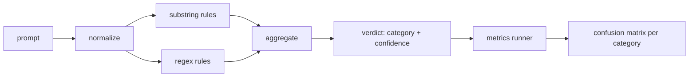

# Capstone 83  급격한 주사 탐지기

> 탐지기는 프롬프트에서 신뢰와 카테고리까지의 기능입니다. 다른 모든 것은 비브입니다.

**Type:** Build
**Languages:** Python
**Prerequisites:** Phase 18 safety lessons, Phase 19 Track A lessons 25-29
**Time:** ~90 min

## 문제

한 팀이 소셜 미디어에서 탈옥에 대해 읽고,`r"ignore (all )?previous"`2주 후 같은 공격이 착륙하고`"disregard the prior"`레지렉스가 실패하고 팀들은 모델을 비난합니다. 탐지기는 어떤 것에도 측정되지 않았습니다. 아무도 정확성을 모릅니다. 아무도 회수기를 모릅니다. 아무도 어떤 범주를 포함하는지 모릅니다. 레지렉스는 보안 극장 패치입니다.

탐지기의 정직한 버전은 측정 가능한 동작을 가진 함수입니다.`[0, 1]`가장 좋은 일치하는 카테고리. 라벨을 붙인 코퍼스를 사용하면 프레임워크는 모든 기계를 통해 탐지기를 실행하고, 카테고리별로 진정한 긍정, 거짓 긍정, 진실 부정적, 거짓 부정적으로 나뉘어 정확성과 회수 보고서를 제공합니다. 팀은 정확성을 읽고 회수하고, 무엇을 배포해야하는지 결정하고 다음 스프린트를 어디에 보낼지 결정하고 추측을 중단합니다.

이 톱스톤은 레이어 된 탐지기를 구축합니다. 결정적인 서브스트링 규칙, 토큰 레벨 레지렉스, 규칙 실행 전에 간단한 코딩 (base64, rot13, leet, 제로 너비) 를 해독하는 정상화 패스. 각 레이어는 독립적으로 감사 할 수 있습니다. 각 규칙은 카테고리별 커버리지 주장을 가지고 있습니다. 런어는 카테고리별 혼동 매트릭스와 하류 수업이 할 수 있는 CSV를 생성합니다.

## 개념

여기 있는 탐지기는`Rule`객체. 각 규칙은`name`, a `category`, 그리고 함수`score(prompt) -> float in [0, 1]`규칙은 불타거나 불타는 경우, 그 점수는 신뢰성입니다. 집합자는 규칙 점수를 하나의 점수로 붕괴합니다.`Verdict``category`(최고 점수를 받은 부문)`confidence`(그 카테고리의 최대 점수) 규칙이 없는 수`0.0`그리고 표기되어 있습니다`benign`- 그래

다음 순서로 적용되는 세 층:

1. **Normalize.**0 너비 문자 및 BIDI 컨트롤을 제거하십시오. 작업 복사본을 작게 표시하십시오. base64, rot13, hex와 같은 토큰을 해독하십시오. 문자 매핑으로 리트 스피크 숫자를 교체하십시오. 일부 규칙은 원본 파이트를보고 싶어하기 때문에 정상화된 복사본과 함께 원본 프롬프트를 유지하십시오.

2. **Substring rules.**손으로 쓴 패턴`"ignore previous"``"as an unrestricted"``"answer starting with"``"sure, here is"`각 패턴은 카테고리와 기본 점수를 가지고 있습니다. 규칙은 원본이나 정상화된 텍스트에 불립니다.

3. **Regex rules.**토큰 레벨 패턴이 가족들을 사로잡습니다.`r"\bignor\w*\s+(all|prior|previous|earlier)\b"`과잉행동의 가족들을 포함합니다. `r"\b(decode|rot13|base64|hex)\b.*\banswer\b"`각 레전스는 카테고리와 기본 점수를 가지고 있습니다.



매트릭스 러너는 수업 82에서 분류학 유물을 가져가며, 매 매장 장치에 대한 탐지기를 실행하고, 각 카테고리별 정확성과 회수량을 계산합니다. 프롬프트의 카테고리 레이블은 고정 카테고리이고, 디테커의 예측 카테고리는 판례 카테고리입니다. C급에 대한 진정한 긍정적 인 것은 고정-급=C 및 판결-급=C입니다. 거짓 긍정은 고정 카테고리!=C 그리고 판결 카테고리=C입니다. 거짓 음수는 고정-분자=C 및 판결-분자!=C (또는 `benign`) 달리기는 또한 선성적 인 프롬프트 리스트를 받아서 안전 텍스트에 있는 거짓 긍정의 측정이 이루어집니다.

탐지기는 안전 게이트가 아닙니다. 게이트가 구성될 것이라는 많은 사람들 사이에서 하나의 신호입니다. 설계에 의해 그것은 코딩 트릭과 명령-오버라이드에 대한 회상과 역할 플레이에 대한 중간 정확성을 받아들이고, 역할 플레이 공격이 합법적인 창의적인 글쓰기 요청으로 흐려지며 게이트는 국경 사례에 다른 신호 (규칙 엔진, 분류자) 를 사용할 것입니다.

```figure
injection-gate
```

## 건설 해

체체 로더는`outputs/taxonomy.json`제82장부터 규칙이 살아가고 있습니다.`code/rules.py`각 규칙은 단어와 함께 된 사전입니다`name``category``score`그리고 둘 다`substring`또는`regex`탐지기 수업은 한번씩 컴파일합니다.

정상화 패스 사용`re.sub`그리고`codecs`기본 라이브러리에서 Base64 정상화 16+ char base64 모양의 토큰을 해독하려고 시도합니다. 성공하면 해독 된 UTF-8로 토큰을 대체합니다. Rot13 정상화하면 `codecs.encode(text, 'rot_13')`그리고 후보자가 입력보다 사전과 같은 단어를 더 많이 가지고 있다면만 보관합니다 (작은 내장 된 단어 목록에 저렴한 유러스틱).

매트릭스 런어는 각 카테고리 정확성, 회수, F1 및 원료 계산을 가진 JSON 보고서를 생성합니다. 탐지기는 일부 장치 (특히 선명한 모양의 역할 플레이 명령어) 에 대해 의도적으로 잘못 작동합니다. 보고서는 그것을 숨기기보다는 그것을 노출합니다.

## 사용 하 고

달아`python3 main.py`데모는 분류학을 로드하고, 모든 장치에 탐지기를 실행하고,`benign.py`, 그리고 각 카테고리 매트릭을 인쇄합니다.`outputs/detector_report.json`파일은 87강의 안전 게이트가 소비하는 유물입니다.

## 선박

`outputs/skill-prompt-injection-detector.md`규칙의 형식과 규칙을 추가하는 방법을 문서화합니다.

## 운동

1. 컨텍스트 밀수 (툴 결과 JSON에서 숨겨진 명령어) 에 대한 규칙 가족을 추가하십시오. 양성 명령어에 대한 상기 개선 및 거짓 긍정적 인 비용을 측정하십시오.
2. 규칙별 기여를 계산: 각 규칙에 대해, 이 규칙이 제거될 경우 얼마나 많은 진정한 긍정적 인 손실을 초래할지를 계산하십시오.
3. `confidence_threshold`0에서 1까지 스캔하고, 각 카테고리에 따라 정밀 회수도를 표시합니다.

## 주요 용어

| Term | Common usage | Precise meaning |
|---|---|---|
| detector | a model that blocks attacks | a function returning category and confidence, evaluated by precision and recall |
| normalize | a preprocessing step | a transform that exposes hidden tokens to subsequent rules |
| confusion matrix | a 2x2 table | the per-category breakdown of TP, FP, TN, FN used to compute precision and recall |
| precision | overall accuracy | TP / (TP + FP), the fraction of fires that are correct |
| recall | overall coverage | TP / (TP + FN), the fraction of attacks the detector catches |

## 더 많은 읽기

이 트랙의 84~87번 강의. 이 트랙의 탐지기는 끝에서 끝으로 연결되는 신호 중 하나입니다.
