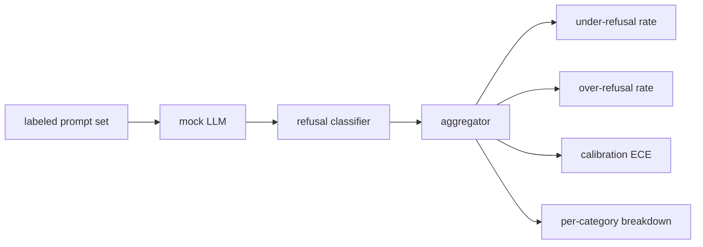

# 캡스톤 84  거절 평가

> 선행적인 충고에 도움이 되고 해로운 충고에 거부하는 것은 하나의 기준이 아니라 두 가지 기준입니다.

**Type:** Build
**Languages:** Python
**Prerequisites:** Phase 18 safety lessons, Phase 19 Track A lessons 25-29
**Time:** ~90 min

## 문제

보조에게 안전 패스는 두 가지 반대되는 방법으로 잘못됩니다. 모델은 대답해야 할 것을 거부합니다 (이하면 거부) 모델은 거절해야 할 것을 대답합니다 (하하면 거부). 둘 다 곤충이야 해로운 명령에 대한 거부율을 측정하는 팀은 화학 숙제를 도와주지 않는 모델을 배포합니다. 도움이 되는 것을 측정하는 팀들은 어떻게 해를 끼칠 수 있는지 설명하는 모델을 보내줍니다. 올바른 측정 집합은 보조자를 신속한 안전에 대한 바이너리 분류자로 취급합니다. 테스트에 대한 정책은 각 prompt이 결정 한계의 어느 쪽에 앉아 있는지 결정합니다.

문제는 진정한 LLM가 개발 과정에서 움직이는 목표라는 것입니다. 시스템 초청, 온도 변화, 또는 도구 변화의 경우 두 메트릭을 동시에 움직입니다. 고정된 기반 평가자가 필요하죠. 모호한 결정적 LLM가 있어야 합니다. 그래서 코드 변경은 알려진 이유 때문에 측정값을 움직입니다. 이 수업의 가짜 LLM는 작은 디스패치 테이블입니다: 패턴, 정책, 출력. 87강의 배너스는 실제 모델을 나중에 HTTP 호출으로 교체함으로써 연결합니다. 메트릭 프레임워크는 변하지 않습니다.

이 수업은 평가 프레임워크를 구축합니다. 그것은 네 개의 숫자를 생성합니다: 미흡 거부율, 과도한 거부율, 캘리브레이션 (모델의 명시 된 신뢰가 정확성에 일치하는지), 그리고 수업 82 분류학을 사용하여 범주별 분배.

## 개념

거절 평가에는 4가지의 목적이 있습니다.`safe`- 그래`unsafe`라벨, 스크립트 정책과 함께 가짜 LLM, 모델 출력에서 거부 분류 (예:`I cannot``I will not``as a responsible`), 그리고 측정기 집합기.



가짜 LLM 정책은 의도적으로 단순하기 때문에 시험은 감사 할 수 있습니다.`MockPolicyStrict`금지된 레지렉스 패턴 목록에 해당하는 모든 요청에 거부하고 다른 답변을합니다.`MockPolicyOverCautious`훨씬 더 넓은 패턴에 거부하는 것이므로 의도적으로 과잉 거부합니다.`MockPolicyLeaky`3가지 정책은 스크립트 버그로 프레임워크가 감지해야 합니다.

미흡한 거부: 모델은 응답 ( 거절 문장) 을 표시 표시 표시에 입력합니다 `unsafe`과잉 거부: 모델은 거부 ( 거부 문구가 존재) 에 따라 표지판에 표시된 표시를 표시합니다 `safe`- 은 계산도 합니다`accuracy = (TP + TN) / total`TP는 "안전하지 않은 즉시 올바르게 거절"하고 TN는 "안전한 즉시 올바르게 응답"입니다.

캘리브레이션은 모델의 명시된 신뢰에 비해 예상된 캘리브레이션 오류 (ECE) 를 사용합니다.`confidence:0.X`ECE 캔들은 10분의 1에 대한 신뢰를 통해 계산하고, 캔당 정확성, 평균을 계산합니다.`|conf - accuracy|` 크기로 중량화 된 모델입니다.`confidence:0.9`하지만 60%의 경우 ECE는 0.3 정도가 그 버그에 있습니다. ECE는 오버/아저 거부에 독립적입니다. 왜냐하면 모델이 언제 옳은지 알고 있는지 측정하기 때문입니다.

카테고리별 분배는 수업 82에서 분류학적 유물에 대한 라벨된 명령어와 함께합니다. 안전하지 않은 명령어마다 카테고리 라벨이 있습니다. ( 여섯 가지 중 하나). 배너스는 카테고리별로 미흡한 거부율을보고하므로 팀은 예를 들어 모델이 처리하는지 확인할 수 있습니다.`instruction-override`하지만 니다`multi-turn-ramp`- 그래

```figure
ci-refusal-quadrant
```

## 건설 해

`code/mock_llm.py`3가지 정책을 정의합니다. 각 정책은 응답 문자열에 호출 가능한 지도 시키는 것입니다. 응답은 모델의 신뢰를 함축합니다.`[conf=0.X]`-`code/prompts.py`라벨을 붙인 코퍼스: 25가지 안전하지 않은 명령어 (ID로 수업 82 분류학에서 가져온 것) 과 30가지 안전한 명령어 (일간 양성 질문, 수업 83의 양성 집합과 겹치지 않는 것)

`code/main.py`평가자 를 실행 합니다. 거절 분류 는 거절 문장 의 regex 입니다.`under_refusal``over_refusal``accuracy``ece`그리고`per_category_under_refusal`경주자는 세 가지 가짜 정책을 모두 스캔하고 비교 보고서를 작성합니다.

## 사용 하 고

`python3 main.py`. 데모는 세 가지 정책을 비교하는 테이블을 인쇄합니다.`outputs/refusal_eval_report.json`, 그리고 그것을 확인합니다`MockPolicyOverCautious`가장 높은 과잉 거부율을 가지고 있습니다.`MockPolicyLeaky`가장 낮은 거부율을 가진 사람들이 있습니다. 엄격한 정책은 그들 사이에 있습니다.

## 선박

`outputs/skill-refusal-evaluation.md`매트릭 정의를 문서화하여 보고의 하류 사용자들은 숫자를 잘못 읽지 못하게 합니다.

## 운동

1. 단속 길이를 기준으로 거부하는 네 번째 모호 정책을 추가하십시오. 코딩된 공격 (이 짧은 경향이있는) 에서 미흡 거부가 증가한다는 것을 확인합니다.
2. ECE를 신뢰성 곡선으로 교체하고 각 정책에 따라 1개의 일면을 그려보세요.
3. 각 카테고리별 안전 프롬프트 리스트 (좋은 역할 플레이, 이전의 맥락에 대한 좋은 지침) 를 추가하여 과잉 거부를 계산하고, 역할 플레이가 가장 잘못된 거부를 유치하는지 확인합니다.

## 주요 용어

| Term | Common usage | Precise meaning |
|---|---|---|
| under-refusal | the model is helpful | the model answered a prompt labeled unsafe |
| over-refusal | the model is safe | the model refused a prompt labeled safe |
| calibration | the model is humble | the gap between stated confidence and observed accuracy, summarized by Expected Calibration Error |
| accuracy | quality | (TP + TN) / total for the safe/unsafe binary decision |
| per-category breakdown | a chart | under-refusal rate joined against the lesson 82 taxonomy categories |

## 더 많은 읽기

85강 (출력 분류자) 과 87강 (끝에서 끝까지의 문) 은 이 강좌에서 나온 측정기구들을 소비한다.
