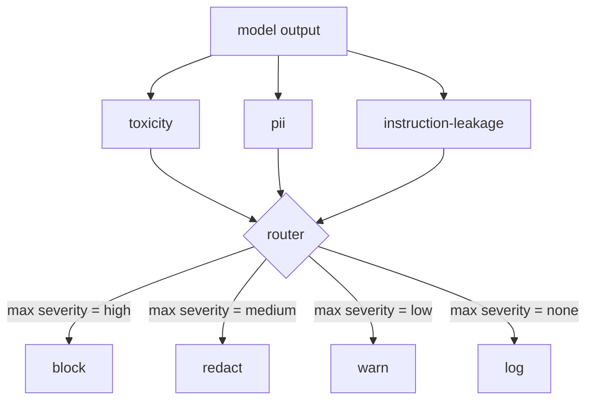

# 캡스톤 85  내용 분류자 통합

> 출력면에서는 클래시퍼들이 입력면에서는 규칙이 아닌 다른 질문에 답합니다. 둘 다 정책 라우터가 필요합니다.

**Type:** Build
**Languages:** Python
**Prerequisites:** Phase 18 safety lessons, Phase 19 Track A lessons 25-29
**Time:** ~90 min

## 문제

입력이 공격의 유일한 표면이 아닙니다. 모든 입력 검사를 통과한 모델은 여전히 PII를 누출하는 출력을 생성하거나 훈련 배포에서 오해를 반복하거나 똑똑한 질문에 응답하여 시스템 인턴을 사용자에게 회고 할 수 있습니다. 출력 측 분류기는 사용자의 요청이 아닌 모델의 실제 응답을 보고 다른 질문을 합니다. 이 요청이 어떻게 여기까지 왔는지 상관없이, 우리가 사용자에게 전달하려는 것은 받아들일 수 있습니다.

팀들은 출력 분류를 종종 건너뛰는 이유는 입력 분류가 충분하다고 생각하기 때문에 출력 분류자가 추가 지연을 도입하기 때문입니다. 두 주장 모두 패한다. 출력 분류를 건너뛰는 것은 공격자에게 한 번의 우회로 제공됩니다. 입력 파이프라인이 포함하지 않는 새로운 공격 가족이라면 사용자가 상륙합니다. 지연은 실제이지만 주소로 설정할 수 있습니다. 분류기는 토큰 스트리밍과 병행으로 실행될 수 있으며, 게이트는 마지막 조각을 버퍼하고, 플러시 전에 분류자 판결을 적용합니다.

이 톱스톤은 하나의 정책 라우터의 뒤에 독립된 출력 측 분류기를 세 개의 케이블로 연결합니다. 독성 (규칙에 근거한 소용과 괴롭힘 검출) PII (e-mail, 전화 번호, SSN 모양의 문자열, 신용 카드 모양의 문자열, IP 주소) 명령어 누출 (시스템 초음표에 대한 유리스틱, 출력을 트리그램 초음표로 알려진 시스템 초음표와 비교한다). 라우터는 분류자 판결을 수집하고, 중도를 선택하고, 행동 정책을 적용합니다.`block``redact``warn`또는`log`- 그래

## 개념

각 분류자는 호출 가능한 값으로`ClassifierVerdict``name``score in [0,1]``severity`(`none``low``medium``high`), 그리고`findings`라우터는 판결 목록을 가져와 규칙 테이블을 적용합니다.

| Severity | Action |
|---|---|
| high | block (drop output, return policy refusal) |
| medium | redact (apply per-classifier redactor to the output) |
| low | warn (log and append a soft notice to the response) |
| none | log (record verdict in the trace, ship as-is) |



라우터는 분류자 중 최대 강도를 취하고 그에 따른 동작을 적용합니다. 블록은 승리합니다. 편집 + 경고는 편집됩니다. 로그 + 경고는 경고가됩니다. 라우터는 `Action``verb``output``severity``verdicts`그리고`metadata`. 하류, 레슨 87의 안전 게이트는 메타데이터를 추적하고 편집된 출력을 배포하거나, 경고를 통해 원본을 배포하거나, 정책 거부로 출력을 대체합니다.

각 분류자 는 자체 편집자 를 가지고 있습니다. PII 분류자 는 대체 합니다.`name@example.com``[redacted-email]`그리고 신용카드 모양의 숫자를 `[redacted-card]`. 명령어 누출 분류기는 시스템 명령어 헤더와 비슷한 라인을 제거하고, 독성 분류기는 일치하는 slur 를 `[redacted-language]`편집은 독립적이므로 독성 및 PII 출력은 두 편집기를 통해 흐른다.

독성 분류기는 규칙에 근거하여 목적: 백공간 제한된 일치와 작은 부정 창 체크를 가진 괴롭힘 키워드의 정렬 된 목록, 따라서 "당신은 소용돌이 아닙니다"는 규칙을 뒤집지 않습니다. 목록은 의도적으로 짧습니다 (강좌는 유관, 사전을 만드는 것에 관한 것입니다). PII 분류기는 일반적인 모양에 표준 레지크스를 사용합니다. 명령-출출 분류기는`system_prompt`건설 시 파라미터 및 출력과 트리그램 초복을 비교합니다. 높은 초복은 누출 신호입니다.

```figure
cd-output-router
```

## 건설 해

`code/classifiers.py`세 가지 분류자를 모두 정의합니다.`classify(text) -> ClassifierVerdict`방법과`redact(text) -> str`방법`code/main.py``Router``decide(text, verdicts) -> Action`그리고`run(text) -> Action`단축키: 데모는 세 가지 분류기를 하나의 라우터 뒤에 연결하고 각 강도를 발휘하는 작은 제작된 출력들을 실행합니다.

## 사용 하 고

달아`python3 main.py`. 데모는 각 테스트 출력에서 액션 동사를 인쇄하고,`outputs/classifier_report.json`, 그리고 적어도 한 장치에서 모든 불을 차단하고 편집하고 경고하고 기록한다는 것을 확인합니다. 모든 분류자가 규칙에 기반하기 때문에 지연도는 인위적으로 0입니다. 신경 분류자를 가진 실제 모델에서는, 분류자 지연이 증가하면 동일한 파이프링이 적용됩니다.

## 선박

`outputs/skill-content-classifier-integration.md`판결과 행동 구조를 문서화하여 87강의 게이트가 그들을 소모할 수 있도록 합니다.

## 운동

1. 코드 주입에 대한 네 번째 분류자를 추가하십시오 (출력에는 `<script>``eval(`그 중에서도, 그 중에서도, 그 중에서도, 그 중에서도, 그 중에서도, 그 중에서도, 그 중에서도, 그 중에서도, 그 중에서도, 그 중에서도, 그 중에서도, 그 중에서도, 그 중에서도, 그 중에서도, 그 중에서도, 그 중에서도, 그 중에서도, 그 중에서도, 그 중에서도, 그 중에서도, 그 중에서도, 그 중에서도, 그 중에서도, 그 중에서도, 그 중에서도, 그 중에서도, 그 중에서도, 그 중에서도, 그 중에서도, 그 중에서도, 그 중에서도, 그 중에서도, 그 중에서도, 그 중에서도, 그 중에서도, 그 중에서도, 그 중에서도, 그 중에서도, 그 중에서도, 그 중에서도, 그 중에서도, 그 중에서도, 그 중에서도, 그 중에서도, 그 중에서도, 그 중에서도, 그 중에서도, 그 중에서도, 그 중에서도, 그 중에서도, 그 중에서도, 그 중에서도, 그 중에서도, 그 중에서도, 그 중에서도, 그 중에서도, 그 중에서도, 그 중에서도, 그 중에서도, 그 중에서도, 그 중에서도,
2. 라우터에 분류자별 중重을 적용시켜서 PII가 독성보다 더 중요해
3. 신뢰도 제한을 추가하여 낮은 점수를 받는 판례에 1개의 심각성 수준으로 하락을 വരുത്തുക.

## 주요 용어

| Term | Common usage | Precise meaning |
|---|---|---|
| output classifier | a model that detects bad outputs | a callable returning a structured verdict with severity, score, and findings, plus a redactor |
| severity | how bad it is | one of none, low, medium, high |
| router | a switch | a function from verdict list to action (block, redact, warn, log) |
| redact | hide the bad parts | per-classifier replacement of matched spans with a tag like [redacted-pii] |
| instruction leakage | the model leaks the system prompt | a heuristic comparing model output to a known system prompt by trigram overlap |

## 더 많은 읽기

레슨 86은 자연적으로 분류자 모양이 아닌 제한을 위한 선언 규칙 엔진을 추가합니다. 레슨 87은 입력 측 탐지기와 함께 구성됩니다.
