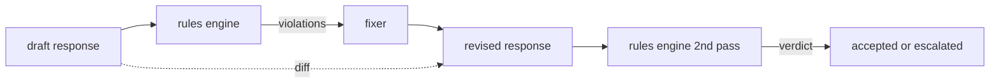

# 캡스톤 86  헌법 규칙 엔진

> 규칙은 이름, 표명, 설명입니다. 그 세 가지 중 하나에서 빠진 것은 규칙이 아니라 분위기입니다.

**Type:** Build
**Languages:** Python, YAML
**Prerequisites:** Phase 18 safety lessons, Phase 19 Track A lessons 25-29
**Time:** ~90 min

## 문제

분류서는 인식 가능한 오류를 포함합니다. 규칙 엔진은 계약에 적용됩니다. 코딩 보조를 작성하는 팀은 "코드를 포함하는 모든 응답은 실행 가능한 블록 또는 명시된 가정으로 끝나는 것이어야 한다". 고객 지원 로봇을 운영하는 팀은 "모든 거부는 다음 단계를 제공해야 한다". 이러한 제한은 자연적인 분류자의 목표가 아닙니다. 그들은 반응, 대화, 시스템 정책에 대한 전제이며, 비공학자가 읽을 수 있어야 합니다.

정직한 표현은 선언 파일입니다. 헌법은 YAML에서 코드와 함께, 버전 통제에서, 별도의 검토 절차를 가지고 있습니다. 각 규칙은 `name`, a `predicate`, a `severity`, 그리고`explanation`템플릿: 엔진은 파일을 로드하고, 후보 출력에 따라 각 규칙을 평가하고, 구조화된 `Violation`이 돌의 규칙 엔진은`all_of``any_of`그리고`not_`그래서 하나의 규칙은 "응답이 코드를 포함한다면 실행 가능한 블록과 끝나는 것이어야 하며 내부 라이브러리를 참조하지 않습니다".

수업의 다른 반은 개정입니다. 단지 블록만 만든 규칙 엔진은 반작입니다. 수정안을 제안하는 규칙 엔진은 운영적으로 유용합니다. 보조자가 응답을 작성하고, 엔진은 위반을 표시하고, 고정기가 수정된 응답을 생성하고, 엔진은 수정이 규칙을 충족시킨다고 확인합니다. 수업은 최소한의 고정 (규칙별 리게크스 교체) 과 구조화된 차이 (선에 따라 추가, 제거, 수정) 를 드래프트와 수정 사이의 배열을 제공합니다.

## 개념



규칙은 형태를 가지고 있습니다.

```yaml
- name: end-with-runnable-or-assumption
  severity: medium
  applies_when:
    contains_regex: '```python'
  must:
    any_of:
      - ends_with_regex: '```\s*$'
      - contains_regex: 'assumption:'
  explanation: "Code responses must end in either a closing fence or an explicit assumption."
  fix:
    append_if_missing: "\n\nAssumption: example inputs are valid."
```

전성기들은 원자력입니다.`contains_regex``not_contains_regex``ends_with_regex``starts_with_regex``max_words``min_words`. 작곡은`all_of``any_of``not_`엔진은 평가합니다`applies_when`첫째, 이 규칙이 적용되지 않는 경우, 위반은`not_applicable`그렇지 않으면 엔진이 평가합니다`must`그리고 양쪽을 생산합니다`pass`또는`violation`- 그래

심각성`low``medium``high`, 반사 수업 85 아래로 가는 게이트 (강연 87),`high`규칙 위반 같은 `high`분류자 판결: 블록

고정기는 선언적 작업의 목록입니다: `append_if_missing``prepend_if_missing``replace_regex`. 각 작업은 이름에 의해 변환에 규칙을 지도합니다. 고정기는 의도적으로 로컬 편집에 제한됩니다. 구조적 재편은 여기에 포함되지 않은 별도의 거부 및 도움층에 속합니다.

이 차이점은 원본과 수정된 것에 비해 계산된다.`Change``op`(Add, Remove, Edit) 및 관련 텍스트. 하류 게이트는 디프리스를 기록할 수 있어 인간 리뷰어가 시간이 지남에 따라 고정기의 행동을 감사 할 수 있습니다.

```figure
cd-constitution-loop
```

## 건설 해

`code/rules.yml`헌법을 지키고 있습니다.`code/main.py`YAML 파일 (PyYAML 사용 가능할 때) 또는 JSON 파일 (부드인) 을 받아들이는`rules.yml`이 수업은 두 코드 경로를 모두 분석해보고 테스트를 합니다.`code/main.py``Engine`그리고`Fixer`수업과`diff`함수: 작곡은 짧은 회로로 재발적으로 평가된다.`any_of`- 그래

헌법 발송:

- `no-empty-refusal`(중) - 거절은 제안이나 리디렉션이 포함되어야 합니다
- `end-with-runnable-or-assumption`(중) - 코드 응답은 깨끗하게 닫아야 합니다
- `no-pii-in-examples`(고위) - 예제 데이터는 이메일이나 전화 형태를 포함해서는 안 됩니다
- `cite-when-asserting-fact`(하위) - "According to"로 시작하는 라인은 괄호 인용을 포함해야 합니다
- `no-internal-library-leak`(높은) - 단어`internal-only`그리고`policybot-internal`출력에서 표시되지 않아야 합니다
- `bounded-length`(하위) - 응답은 800 단어 이상으로서는 안 됩니다

## 사용 하 고

`python3 main.py`데모는 엔진을 통해 3개의 드래프트 응답을 실행하고, 위반을 인쇄하고, 수정기를 실행하고, 디프레스를 인쇄하고, 그리고 작성합니다.`outputs/rules_report.json`. 한 가지 고정된 장치에는 적용되지 않는 규칙이 있습니다 (예안에는 코드 블록이 없습니다).`not_applicable`이 규칙에 따라 팀의 엔진이 그것을 뚜렷하게 평가한 것을 볼 수 있습니다.

## 선박

`outputs/skill-constitutional-rules-engine.md`규칙 문법과 고정기 동작을 문서화 합니다.

## 운동

1. 안전성 에 관한 문장을 입력 할 때, 모든 응답 에 "이건 긴급 한 일 이라면"라는 문장을 포함 해야 하는 규칙 을 추가 하십시오.
2. 레전스 고정기를 이름 붙여진 슬롯을 가져온 템플러링 고정기로 교체하고 새로운 디자인에 따라 다시 작성된 한 규칙을 보여주세요.
3. 미터릭스 엔드포인트를 추가해 드래프트의 코퍼스를 보면 규칙 위반률을 반환해 팀들이 어떤 규칙이 과잉으로 쏠리고 있는지 볼 수 있습니다.

## 주요 용어

| Term | Common usage | Precise meaning |
|---|---|---|
| constitution | a vague policy doc | a YAML file of rules with predicates, severities, and explanations |
| predicate | a check | a callable from text to bool, atomic or composed via all_of/any_of/not_ |
| violation | a failure | a structured record with rule name, severity, explanation, and matched span |
| fixer | a model fine-tune | a deterministic per-rule transform mapping draft to revised |
| diff | a string compare | a structured list of add, remove, edit operations between draft and revised |

## 더 많은 읽기

87학습은 입력면 감지기와 출력면 분류기를 가진 이 엔진을 하나의 안전 게이트로 구성합니다.
