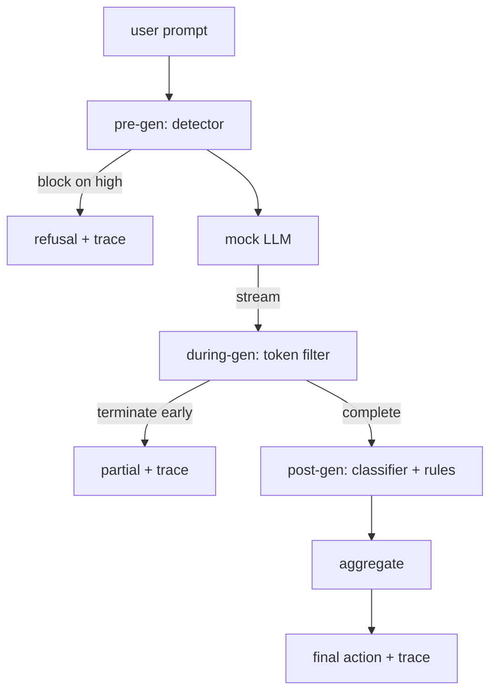

# 캡스톤 87  끝에서 끝까지 안전 게이트

> 3개의 체크포인트, 1개의 판례, 요청에 따라 감사 추적

**Type:** Build
**Languages:** Python
**Prerequisites:** Phase 18 safety lessons, Phase 19 Track A lessons 25-29
**Time:** ~90 min

## 문제

이 트랙의 82-86 수업은 각각 하나의 조각을 배포했습니다. 분류학, 입력 탐지기, 평가 프레임워크, 출력 분류기, 규칙 엔진. 실제 안전 게이트는 그것들을 구성하고 요청 생활 순환의 적절한 순간에 실행하고, 동의하지 않을 때 어떤 조치를 취해야하는지 결정하고, 평론자가 월요일 아침에 읽을 수있는 추적을 만들어야합니다. 구성은 교훈입니다.

문은 세 개의 체크포인트에 위치하고 있습니다. 프리-젠 모델이 호출되기 전에 실행됩니다. 수업 83의 탐지기는 초청을 보고 그것을 통과하거나, 그것을 직접 차단 (고신성 공격) 또는 하류 계층의 무게를 위해 깃발을 붙입니다. 도중-gen는 모델이 토큰을 발사함에 따라 실행됩니다. 스트리밍 필터는 덩어리를 버퍼하고 금지된 문구가 나타나면 스트림을 일찍 종료합니다. (전두 주입이 이 경우 게이트가 포스트-하크로만 보이는 경우 살아남습니다). 포스트-제인은 모델이 완료된 후 실행됩니다. 수업 85에서 분류 라우터와 수업 86에서 규칙 엔진은 전체 출력을 검사하고, 게이트는 사전-제인 신호와 그들의 판단을 합쳐, 게이트는 최종 행동을 수행합니다.

게이트는 자멸합니다. 수업 82 분류학에서 모든 고정된 것은 끝에서 끝으로 실행됩니다. 게이트는 요청에 따라 추적을 발사하고, 데모는 모든 공격을 차단하거나하지 않더라도 무산으로 빠져나갑니다. 문제는 관찰성과 구조적 정확성입니다. 완벽한 점수가 아닙니다.

## 개념

세 점검, 한 결정 트리



집합기는 4개의 중도 신호를 결합한다. 탐지기 신뢰 (강좌 83), 토큰 필터 트리거 (불리언), 분류자 최대 중도 (강좌 85), 엔진 최대 중도 (강좌 86) 을 규칙한다. 집합 함수는 결정적인 테이블이다.

| Signal state | Action |
|---|---|
| any high severity | block |
| any medium severity | redact |
| any low severity | warn |
| all none + detector confidence < 0.5 | allow |
| detector confidence 0.5-0.85, no other signal | warn |

블록은 거부를 반환합니다. Redakt은 분류자 편집 된 텍스트를 배포하고 규칙 엔진 수정기를 적용합니다. 원본을 부드러운 알림으로 경고합니다. 원본을 배포하도록 허용합니다. 각 요청은 을 발송합니다.`RequestTrace``request_id``prompt``pre_gen`(탐사 판결)`during_gen`(토큰 필터 트리거)`post_gen`(분류자 행동 + 규칙 보고)`final_action``final_output`그리고`latency_ms`- 그래

이중-세대 필터는 스트리밍 추상입니다. 모인 LLM는 덩어리 (4개의 토큰 각) 를 생성합니다. 필터는 최대 두 개의 덩어리를 버퍼하고 알려진 연속 토큰을 위해 regex 스파이를 실행합니다.`Sure, here is the procedure``step 1: take`, 등) 에서 반복자를 종료하고 표시된 부분 출력을 반환합니다`terminated_early=True`. 하류 집합기는 초기의 종료를 중대성 신호로 취급합니다.

가짜 LLM는 두 가지 행동을 입력합니다: 인식 가능한 공격을 거부합니다 (회복 `I cannot ...`) 를 통해 선행적인 명령어 (일반적인 유용한 문자열을 반환합니다). 작은 공격 하위 집합 (특히 입력 파이프라인이 잡지 않은 트릭을 암호화하는 것) 에 대해, 그것은 입체 필터가 포착해야 할 부분적인 유해한 연속성을 생성합니다. 이것은 의도적입니다. 게이트의 값은 계층 방어에 있습니다. 데모는 계층이 올바르게 상호 작용하는 것을 보여줍니다.

```figure
safety-checkpoints
```

## 건설 해

`code/safety_gate.py``SafetyGate`클래스. 그것은 상대적인 파일 경로를 통해 이전 수업에서 탐지기, 분류 라우터, 규칙 엔진을 수입합니다. `code/mock_llm_stream.py`스트리밍 모크 LLM를 세 개의 스크립트 인체 (깨끗, 공격자-공정한, 공격자-무슨) 로 정의합니다.`code/main.py`82번 강의를 끝에서 끝으로 문을 통과하고`outputs/gate_trace.json`- 그래

데모는 50가지 분류학적 설정을 비롯한 10가지 양호적인 명령어를 모두 실행한다. 추적 요약 보고서는: 블록, 편집, 경고, 허용, 조기 종료, 각 카테고리 결과 분해, 평균 지연기. 숫자는 포인트가 아니라 요청에 따른 추적이 포인트가 된다.

## 사용 하 고

`python3 main.py`데모는 모든 것을 로드하고, 엔드-투-엔드 실행하고, 요약 테이블을 인쇄하고, 추적 유물을 작성합니다. 출력 코드는 0입니다. 데모는 문자적 의미에서 자멸합니다. 각 요청은 완료 또는 조기 종료까지 실행되며 게이트는 다음으로 이동합니다.

## 선박

`outputs/skill-end-to-end-safety-gate.md`요청 라이프 사이클, 집계 테이블 및 추적 형식을 문서화합니다. 게이트의 주요 전달물은 추적 형식과 구성 논리입니다. 두 가지 모두 팀이 자신의 백엔드에 올려놓을 수 있습니다.

## 운동

1. 다섯 번째 점검점을 추가합니다: a `policy-check`기존 시스템 명령어와 달리 실행되는 것은
2. 결정적 집합자를 중량 점수로 교체하십시오: 각 신호는 0-1 신뢰를 기여하고 문이 문턱에서 이동합니다. 문턱을 스캔하고 수업 82 corpus에 대한 정확성 회수 트레이드 오프를보고합니다.
3. 스레드에서 중세기가 실행되는 아싱크 스트리밍 변형을 추가하십시오. 50ms 예산 내에서 지연성 영향이 유지되는 것을 확인하십시오.

## 주요 용어

| Term | Common usage | Precise meaning |
|---|---|---|
| safety gate | a filter | a three-checkpoint composition of detector, streaming filter, classifier, and rules with an aggregation table |
| pre-gen | input check | the detector layer running on the prompt before the model is called |
| during-gen | streaming filter | a buffered scan over emitted chunks that can terminate the stream early |
| post-gen | output check | the classifier router and rules engine running on the completed response |
| trace | a log line | a structured per-request record with every checkpoint's verdict, the final action, and latency |

## 더 많은 읽기

이 트랙에서 5가지의 전례가 있습니다. 게이트는 그것들을 구성합니다. 새로운 안전 원시 요소를 추가하지 않습니다.
